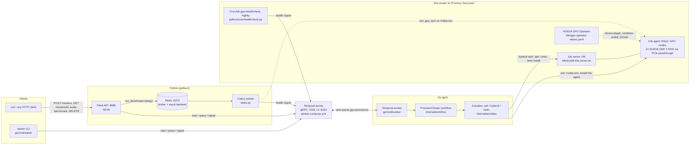

# GPU Cluster Provisioner

[](https://github.com/georgejpark/gpu-provisioner/actions/workflows/ci.yml)

## What it is

Turn a set of GPU machines into a running Kubernetes cluster with one API call, and keep it that way.

A **Temporal** workflow written in **Go** owns the provisioning state machine: prepare each node, join it to k3s, install the NVIDIA GPU Operator, validate every GPU, then stay alive to handle scale-out, scale-in, nightly health reports and teardown. A **Flask** API in **Python** exposes that as `POST /clusters`. **Celery** workers run the slow one-off jobs (burn-in, benchmarks). A Kubernetes **CronJob** feeds health checks back into the workflow.

The target hardware is a home **Proxmox** host, **pve2**, with two **NVIDIA CMP 170HX** GPUs passed through to k3s node VMs, not a cloud. There is no AWS/Azure/GCP SDK and no Terraform anywhere in the repo; the only things it talks to are Temporal, Redis, `ssh`, `kubectl` and `helm`. The cloud-dependency check, the VM plan for pve2 and the test plan are in [proxmox/README.md](proxmox/README.md). (The lab network is a Cisco Nexus 9K fabric.)

## Architecture



## Why Temporal, and why Celery too

Provisioning a cluster is a long job with many steps that can each fail, and it must not be lost halfway through. Temporal records every step, retries failed activities with backoff, and lets the workflow sleep for days waiting for a signal, surviving worker restarts. That is exactly what a cluster lifecycle needs.

Celery is for the opposite case: short, fire-and-forget jobs where "run it again" is fine. Benchmarks and burn-in belong there. Keeping both shows when each tool fits.

## Run it

Everything below uses the targets in the [Makefile](Makefile) and the stack in [docker-compose.yml](docker-compose.yml) (Temporal dev server + UI, Redis). Run `make` from the repo root.

Requirements: Docker, Go 1.24+ (`go/go.mod`), Python 3.11+ (the Dockerfile and CI use 3.12).

| `make` target | What it runs |
|---|---|
| `make up` / `make down` | `docker compose up -d` / `docker compose down`: Temporal (gRPC :7233, UI :8233) and Redis (:6379) |
| `make test` | `cd go && go test ./...`: 4 workflow tests in Temporal's in-memory test environment, no server needed |
| `make tidy` | `cd go && go mod tidy` (optional; `go.sum` is committed) |
| `make worker` | `cd go && DRY_RUN=1 go run ./cmd/worker`: simulates ssh/kubectl/helm with 2 s sleeps |
| `make worker-real K3S_URL=https://192.168.1.201:6443` | `DRY_RUN=0` worker: real ssh/kubectl/helm against your nodes |
| `make api` | `cd python && FLASK_APP=api flask run -p 8080` (needs the Python venv active) |
| `make celery` | `cd python && celery -A tasks.celery worker --loglevel=info` (needs the Python venv active) |

### Dry run in 15 minutes, no cluster needed

```bash
# 1. Temporal + Redis
make up                          # Temporal UI: http://localhost:8233

# 2. Go worker in dry-run mode (simulates ssh/kubectl/helm with 2s sleeps)
make test                        # 4 workflow tests, run in Temporal's in-memory test env
make worker                      # leave running in a terminal

# 3. Start a cluster from the CLI. In dry-run mode the node names and addresses
#    are just labels; nothing is contacted.
cd go
go run ./cmd/starter create lab1 gpu-node-1=192.168.1.210:1 gpu-node-2=192.168.1.211:1
go run ./cmd/starter status lab1          # watch phases: pending -> preparing -> joining -> validating -> ready
go run ./cmd/starter scale  lab1 add gpu-node-3=192.168.1.212:1
go run ./cmd/starter health lab1 gpu-node-2 false "simulated failure"   # cluster goes degraded
go run ./cmd/starter destroy lab1
cd ..

# 4. Same thing through the Flask API (the venv lives in python/.venv, which git ignores)
python3 -m venv python/.venv && . python/.venv/bin/activate && pip install -r python/requirements.txt
make api            # terminal A, venv active
make celery         # terminal B, venv active
curl -X POST localhost:8080/clusters -H 'content-type: application/json' \
  -d '{"clusterId":"lab2","nodes":[{"name":"gpu-node-1","address":"192.168.1.210","gpus":1}]}'
curl localhost:8080/clusters/lab2
curl -X POST localhost:8080/clusters/lab2/benchmark      # Celery job -> health signal
curl -X DELETE localhost:8080/clusters/lab2
```

Note that the Celery benchmark is not dry-run aware: `tasks.py` really runs `ssh root@<address>`. With an address that does not answer, the job reports `passed: false` and the workflow marks the cluster `degraded`, which is itself a good demo of the health path.

Open the Temporal UI and click the workflow: every activity, retry and signal is in the event history. That history is the demo.

### For real on the Proxmox host (pve2)

The full plan, VM sizes, GPU passthrough commands and test plan are in [proxmox/README.md](proxmox/README.md). The short version:

1. Pick a control-plane host (a small VM is fine). Run `k8s/install-k3s-server.sh` there. It prints `K3S_URL` and `K3S_TOKEN`. Copy `/etc/rancher/k3s/k3s.yaml` to `~/.kube/config` on the machine that runs the Go worker and replace `127.0.0.1` with the server's address.
2. On each GPU node VM: the CMP 170HX card(s) passed through, the NVIDIA driver installed in the guest and `nvidia-smi` working, `nvidia-container-toolkit` installed, and ssh key auth from the worker machine as root (or set `SSH_USER`). The VM's hostname must equal the node name you pass to `starter create`, because the workflow runs `kubectl wait node/<name>` with it.
3. Start the worker for real, from the repo root (`192.168.1.201` is the k3s server address used in the plan; use whatever the install script printed):
   ```bash
   make worker-real K3S_URL=https://192.168.1.201:6443
   ```
4. Create the cluster with the real token, read live from the k3s server:
   ```bash
   cd go && K3S_TOKEN=$(ssh root@192.168.1.201 cat /var/lib/rancher/k3s/server/node-token) go run ./cmd/starter create lab1 gpu-node-1=192.168.1.210:2
   ```
   The workflow will ssh to the node, install the k3s agent, wait for `Ready`, helm-install the GPU Operator with `k8s/gpu-operator-values.yaml` (host driver, k3s containerd paths), then read `nvidia.com/gpu` allocatable and run a single-node `all_reduce_perf` if `nccl-tests` is on the node.
5. Optional: `kubectl apply -f k8s/nccl-test-job.yaml` to run nccl-tests inside the cluster on 2 GPUs (both cards must be on one node).
6. Deploy the nightly check: build `python/Dockerfile`, push it, edit the image and `TEMPORAL_ADDRESS` in `python/cron/healthcheck-cronjob.yaml`, create a ServiceAccount with `get,list` on nodes, and `kubectl apply`. Exact commands are in [proxmox/README.md](proxmox/README.md).

## Layout

```
.github/workflows/ci.yml  GitHub Actions: Go build/vet/test, Python compile/import, Docker build (no push)
go/
  cmd/worker        Temporal worker (DRY_RUN=1 simulates, DRY_RUN=0 runs ssh/kubectl/helm)
  cmd/starter       CLI: create / status / scale / health / destroy
  internal/workflow ProvisionCluster workflow: state machine, signals, query, retries
  internal/activities
                    Activities + Runner interface, DryRunner and ShellRunner
python/
  api.py            Flask API (start/query/signal the Go workflow)
  tasks.py          Celery benchmark job that reports back via a health signal
  temporal_client.py
  cron/             healthcheck.py + CronJob manifest
  Dockerfile        python:3.12-slim + kubectl, runs the API under gunicorn
k8s/                GPU Operator values, k3s server install, nccl test job
proxmox/            Cloud-dependency verdict, pve2 VM plan with CMP 170HX passthrough, test plan
docker-compose.yml  Temporal dev server + UI, Redis
```

## CI

[`.github/workflows/ci.yml`](.github/workflows/ci.yml) runs on every push and pull request to `main`, on GitHub-hosted runners, with read-only permissions and no secrets:

- **Go**: `go build ./...`, `go vet ./...`, `go test ./...` with the Go version from `go/go.mod`.
- **Python**: `pip install -r python/requirements.txt`, `python -m compileall`, and an import of `api`, `tasks`, `temporal_client` and `settings` (no services needed). There is no pytest suite yet.
- **Docker**: builds `python/Dockerfile` with `push: false`.

## Things to be able to explain in an interview

- **Determinism.** The workflow function never calls the network, the clock, or random. All of that is in activities. That's what lets Temporal replay the history after a crash.
- **Retries.** Activities retry 4 times with 10s → 2m backoff. A node that still fails is recorded as `failed`; the cluster becomes `degraded`, not dead. Only a GPU Operator install failure fails the whole workflow, because nothing works without it.
- **Signals vs queries.** Signals (`scale`, `teardown`, `health`) change state. The `status` query reads it without touching the database. The API has no database of its own.
- **Why `InstallGPUOperator` runs once, after the joins.** The operator needs a node to land on; validation needs the operator. Order matters, and the workflow encodes it.
- **Workflow ID = `cluster-<id>`.** Starting the same cluster twice is rejected by Temporal, which is the idempotency guarantee for free.
- **What I'd add next.** Child workflows per node for very large clusters, a Temporal schedule instead of the Kubernetes CronJob, continue-as-new to keep the event history bounded, multi-node NCCL validation, and Proxmox API activities to clone VMs so "create" starts from nothing.

## License

MIT, see [LICENSE](LICENSE).
